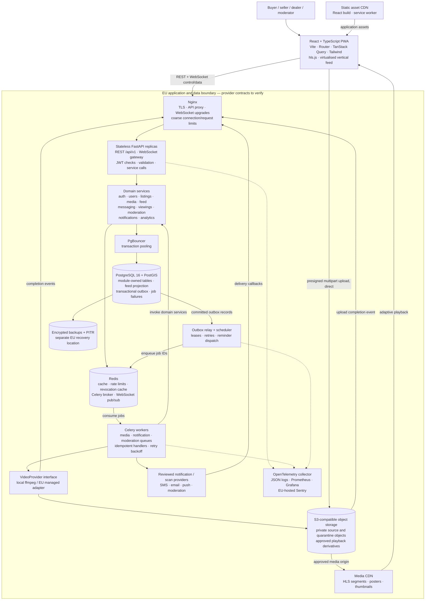

# 2. Architecture

Motorloop is a modular monolith: one Python backend, independently scalable API and worker containers, one PostgreSQL source of truth, and explicit module interfaces. The frontend is a mobile-first React PWA. Video bytes travel directly between clients, storage and the media CDN.

This is the production-oriented target architecture, accompanied by a local development scaffold. The later documents contain sequence diagrams, SQL DDL, endpoint tables, costs and the implementation inventory. The user explicitly overrode the original pause checkpoints and requested the complete delivery without further stops.

**Implementation boundary:** local auth, listings, S3 multipart upload, ffmpeg HLS processing, feed, messaging, viewings, reporting/blocking, admin actions, dealer import and consented event ingestion have code paths. Notifications currently persist in-app records only. Production SMS, outbound push/email, managed video processing, sampled-frame moderation, public notices, appeals, export/deletion operations and operational residency guarantees remain release gates; `APP_ENV=production` deliberately rejects startup. Source inspection here does not establish runtime validation; use the separate verification report.

## Component diagram

The CDN nodes are outside the application boundary deliberately: EU origin hosting alone does not establish where edge copies, logs or notification metadata are processed. Deployment must enforce the agreed EU policy or select a restricted delivery alternative before production launch.

## Components and trade-offs

### React PWA

React with strict TypeScript, Vite, React Router, TanStack Query and Tailwind provides the mobile-first interface; features live under feed, listing, chat and viewings. A virtualised feed mounts only a small window, plays only the visible item, preloads the next two at the lowest rendition, cancels stale work and releases off-screen players; hls.js supplies adaptive playback where native HLS is unavailable. A PWA keeps a solo developer on one client codebase, at the cost of browser-specific media and notification behaviour that must be tested on real phones.

### Static and media delivery

The built React application comes from a static CDN, and approved HLS, poster and thumbnail assets come from a media CDN with immutable versioned object keys. Service-worker caching covers the app shell and public assets only; authenticated API responses, messages, tokens and private meeting details are excluded. Keeping delivery off the API reduces server load, while removal and privacy requirements still demand origin restrictions, CDN purge support and bounded cache lifetimes.

### Nginx edge

Nginx terminates TLS, forwards API requests and WebSocket upgrades, constrains payload sizes and applies coarse IP/connection limits; API limits are stricter and use verified identity and account age. Locally it also serves the React build at the same origin as `/api/v1`, reducing cookie and CORS complexity; production can route static assets through the CDN. It is a simple common ingress, but production needs multiple healthy edge instances or a managed ingress to avoid a single point of failure.

### FastAPI application

FastAPI on Python 3.12 uses Pydantic v2, async SQLAlchemy 2, Alembic and pydantic-settings; routers translate HTTP into service calls and never issue database queries. Every request carries a trace/request ID, errors use one stable envelope, lists use opaque cursors, and mutation contracts define idempotency scope and conflict handling. Shared PostgreSQL/Redis state makes replicas replaceable; video work and slow external calls stay outside request handlers.

### Domain module boundary

Each module exposes service methods, schemas and domain events, and privately owns its repositories and tables. Cross-module reads go through the owning service. The scaffold updates the feed-owned projection synchronously through public interfaces within the publication/removal transaction, then emits outbox cache invalidation; an independently event-fed rebuildable projection is the later scaling path. A shared database permits this coordination without adding network calls or premature microservices.

| Module | Owned responsibility | Public interactions |
| --- | --- | --- |
| auth | OTP challenges, credentials, refresh sessions, token issuance/revocation | Requests identity facts from users; supplies verified authentication context |
| users | Accounts, contact details, permissions, dealer profiles, account status | Supplies minimal identity/permission facts and account lifecycle events |
| listings | Listing lifecycle, common fields, typed car details, saves, dealer import records | Coordinates publication with media/moderation results; emits listing events |
| media | Upload sessions, asset metadata, processing state, video provider adapters | Supplies playable asset facts; emits ready, rejected and failed events |
| feed | Geographic candidate projection, ranking, cursor sessions, candidate caches | Consumes listing/media events and consented engagement aggregates; checks current visibility through public services |
| messaging | Conversations, messages, read positions, message idempotency | Requests listing access and block checks; emits persisted-message events |
| viewings | Proposals, responses, counterproposals, reminder state, calendar exports | Checks conversation membership through messaging; emits structured chat and reminder events |
| moderation | Reports, blocks, review cases, actions, appeals and audit reasons | Exposes policy/block decisions; invokes owning services to remove content or suspend accounts |
| notifications | Local in-app notification records; production preferences/subscriptions/delivery attempts planned | Consumes committed events; outbound provider adapters remain a release gate |
| analytics | Consented append-only product events and aggregate engagement signals | Supplies bounded aggregates to FeedRanker; enforces consent and retention policies |

Administrative UI routes are another frontend feature protected by server-side admin authorization. Dealer imports create normal drafts and media sessions through listing/media services, so CSV ingestion cannot bypass verification, moderation or publication checks.

### PostgreSQL, PostGIS and PgBouncer

PostgreSQL 16 is authoritative for accounts, listings, chat, viewings, moderation and committed events; PostGIS supports radius search on geographic points and a GiST-indexed feed projection. PgBouncer uses transaction pooling; the scaffold selects SQLAlchemy's async psycopg driver with `NullPool` and `prepare_threshold=None` and avoids session-state assumptions. Runtime compatibility checks are recorded separately. One managed database is easier to maintain than separate domain databases, while connection limits, hot indexes and write amplification remain capacity constraints to measure.

### Redis

Redis supplies short-lived geographic candidate caches, distributed rate limits, a token-revocation cache, Celery transport and best-effort WebSocket fan-out; correctness-critical records remain in PostgreSQL. Development uses one instance with separate key prefixes; production can isolate the broker from evictable cache traffic without changing application interfaces. Feed cache/ranking failures fall back to PostgreSQL recency, while verification, messaging abuse controls and other safety-sensitive checks fail closed when their authoritative decision cannot be obtained.

### Transactional outbox, relay and scheduler

A domain mutation and its durable event/outbox record commit in the same database transaction; a relay claims records with expiring leases, enqueues job IDs, and records dispatch progress. Delivery is at least once, so worker effects are deduplicated by stable event/job IDs and guarded state transitions; queue acceptance alone is not completion, and reconciliation redispatches expired work until a durable terminal result exists. This adds a small relay process but closes the database-commit/queue-publish gap and makes Redis disruption recoverable.

The scheduler uses durable reminder records and database leases so multiple replicas do not send the same reminder intentionally; external providers receive stable idempotency keys where supported. Exhausted jobs enter a PostgreSQL-backed dead-letter record with redacted error details and an explicit replay path rather than disappearing into transient broker state.

### Celery workers

Choose Celery for mature routing, retry controls and scheduling integration. The scaffold routes media jobs to `media` and other work to `default`; its local worker consumes both, while production should use independent workers and separate notification/moderation queues so encoding cannot starve contact or verification work. Workers invoke public services and use durable outbox retry/backoff/dead-letter state; reviewed provider adapters must supply external-effect idempotency before real sends are enabled. Celery has more configuration than Dramatiq, but its established operational controls fit the multiple workload types in this brief.

### VideoProvider and object storage

Media services issue fifteen-minute object-scoped multipart part URLs after creating an authorized draft; clients upload parts directly to private storage, and finalization verifies ownership, ordered ETags and exact uploaded size. The local ffmpeg worker probes MP4/MOV and duration, removes audio/metadata, produces two HLS renditions plus poster/thumbnail images, and derives a poster dHash for duplicate review. Processed derivatives stay under a private `sources/processed` prefix until local text/hash checks or an admin approval permit copying into the playback origin. Production sandbox hardening, sampled-frame scanning, lifecycle cleanup and an EU managed-transcoding adapter remain release gates.

Local S3 storage uses pinned **SeaweedFS 4.48** instead of the initially considered MinIO image, which was unavailable from Docker Hub during setup. The application still uses the S3 API and `VideoProvider` boundary; the official [SeaweedFS `weed mini` guide](https://github.com/seaweedfs/seaweedfs/wiki/Quick-Start-with-weed-mini) documents the local S3-compatible setup. This choice does not change the proposed managed EU production storage target.

The API handles upload metadata and status only, never video bytes. Multipart allocation/finalization are bounded storage-control calls made from request services through a thread boundary; bulk processing runs in workers. Authenticated client finalization is implemented; signed provider/storage callbacks and robust post-timeout reconciliation are planned and cannot independently declare a video safe or a listing live. Completion uses WebSocket status events with owner polling as fallback; the two-minute target remains to be measured with representative videos.

### Real-time gateway and durable messaging

A message is sent by REST with a client idempotency key, authorized against membership, current account state and block rules, then persisted with an outbox event before delivery. WebSocket gateways distribute committed events through Redis pub/sub across replicas; reconnecting clients fetch durable history using message cursors because pub/sub does not replay missed events. Read positions are persisted, scam-pattern warnings are attached to messages, and account contact details are never included implicitly in chat payloads.

The `/ws` gateway uses a same-origin thirty-second one-use ticket minted by an authenticated REST request and supplied in the first frame, with Origin validation and repeated session/status revalidation; access or refresh tokens are not placed in URLs. Events use `{type, data}`, with user-scoped Redis channels, membership checks for conversation events and transport heartbeats. Connection state is ephemeral and history is recovered from PostgreSQL after reconnect. Notification work currently stores durable in-app records; offline detection and real push/email delivery are planned.

### Authentication and authorization

Access JWTs expire after ten minutes and are kept in client memory; opaque refresh credentials rotate on a fourteen-day session lifetime in HttpOnly, SameSite Strict cookies, Secure when a future production configuration is enabled, with only token hashes persisted and family reuse triggering revocation. Cookie-bearing auth mutations enforce exact Origin checks; local OTP challenges have expiry, attempt ceilings and per-phone/IP limits. The development OTP is explicitly simulated; queued production SMS and a complete deployed CSRF assessment remain release gates. Verification, adult declaration, ownership, dealer/admin permissions and active-account checks are enforced by services rather than trusted from frontend controls or stale JWT role claims.

For logout/suspension, PostgreSQL records revocations and active-session state; Redis accelerates checks and invalidation reaches live sockets. If the cache is unavailable, sensitive actions consult authoritative session/account services or reject safely. Local development OTP bypasses must be conspicuously labelled, forbidden by production configuration validation and absent from public response payloads in production.

### Feed projection and ranking

The feed owns a PostGIS projection of eligible listings and public media facts; its engagement column is ready for later validated aggregates, while the local ingestion pipeline currently populates consented seen-item sets. Geographic-cell-prefixed candidate caches also include exact filters/centre and use thirty-second TTLs plus outbox-driven region revisions. FeedRanker applies recency, a capped engagement term and seen penalties; a five-minute snapshot freezes up to 150 IDs and binds cursors to filters/identity. Current listing visibility, seller status and block rules are checked through owning services before each page.

This keeps ranking separate from listing writes. Expired snapshots and Redis loss while continuing a ranked cursor return `410` with a restart instruction; a new request with unavailable cache or a failed ranker falls back to PostgreSQL recency using `(published_at, id)` keyset cursors. Detailed scoring, cache keys, consent handling and invalidation limits are in deliverable 6.

### Viewings and notification adapters

Viewings are structured proposals attached to a conversation, with timezone-aware timestamps, meeting-place text, status and revision; counters preserve previous proposals. Membership checks and locked revision transitions protect responses, accepted viewings have an authenticated `.ics` export, and the scheduler enqueues reminders within an hour of the meeting. Local reminders become in-app database records; stale-reminder suppression at delivery and real outbound channels remain production work. Public-place guidance belongs in the user flow, and precise meeting details stay out of telemetry/provider previews.

### Moderation, privacy and safety

Publishing requires uploader rights confirmation, seller eligibility, media readiness and a moderation decision. The local implementation routes text/contact-detail and matching poster-hash signals to its report queue, supports symmetric blocks and reasoned admin approve/remove/suspend actions, and annotates scam-pattern chat warnings. Sampled-frame scans, price-anomaly models, affected-user statements of reasons, appeals and a public non-account notice route remain production release gates. Hash similarity is a review signal, not proof of theft; legal applicability and retention are assessed in deliverable 8 for legal review.

Export and deletion are designed authenticated workflows to coordinate through module services and background jobs, including storage, CDN and provider cleanup; their endpoints are not implemented in this scaffold. Legal holds and narrowly justified retention need explicit policy. Provider selection must account for processing and transfers as well as nominal EU storage location; local success does not establish GDPR or DSA compliance.

### Observability and recovery

Structured JSON logs and OpenTelemetry traces correlate API requests, outbox events, worker jobs and provider callbacks; Prometheus/Grafana show API latency/errors, queue age/depth, processing duration, dead letters, projection lag and WebSocket health. A proposed EU-hosted Sentry deployment captures scrubbed exceptions, with no OTPs, JWTs, message bodies, phone numbers or exact meeting details in telemetry. Daily backups plus PostgreSQL point-in-time recovery, encrypted EU copies, object recovery policies and scheduled restore drills support a provisional recovery objective of 15 minutes of database data loss and four hours to restore, to be costed and validated later.

Processes expose liveness and dependency-aware readiness through HTTP or equivalent container health commands: API, worker, relay, edge, PostgreSQL/PgBouncer and Redis all have explicit probes. The feed can remain available in degraded mode when Redis is unavailable; queue-dependent operations such as SMS delivery expose a pending or temporarily unavailable result instead of claiming completion. Operations documentation will specify which dependency failures remove a replica from service and which only change a feature's status.

### Local development and delivery

The scaffold defines Docker Compose services for Nginx, API, Celery workers, outbox relay/scheduler, PostgreSQL/PostGIS, PgBouncer, Redis and pinned SeaweedFS S3 storage, with synthetic seeded media. Development defaults are explicitly local-only and production settings reject startup until the release gates are complete. CI/check definitions cover backend/frontend lint, typing, tests, migrations and builds; the separate verification report records what actually ran and any remaining limits.

## Configuration and growth boundary

- **Regions:** Region records/configuration define boundaries, currency, timezone, supported locales and policies; listing/feed queries carry `region_id` from the start.
- **Categories:** Common listing fields are stable; category adapters define validation, typed attributes, filter metadata and display labels. Adding a category requires an adapter and migration, not a rewrite of auth, chat, media or viewings.
- **Providers:** Video, storage, SMS, email, push and scanning use narrow interfaces with separate development and production adapters; avoid a generic plugin framework before a second implementation exists.
- **First extraction:** Media processing would be the first service split if encoding load, sandbox isolation or independent deployment requires it; its asset IDs, provider interface and durable events already form a boundary.
- **Later load:** API and worker replicas scale independently first; database tuning, read projections and a selectively used replica precede splitting transactional domains. Exact 10×/100× bottlenecks and cost maths follow in deliverable 7.

## Delivery status

The user explicitly instructed continuing through all deliverables without further checkpoint pauses. This architecture distinguishes the production target from the local scaffold and does not imply production readiness or runtime validation; consult deliverable 9 and the final verification report for executable status and release gates.

## Technical checks and references

- SQLAlchemy/driver prepared-statement behaviour requires deliberate PgBouncer configuration rather than combining defaults blindly. The scaffold uses async psycopg, disables automatic preparation and leaves connection pooling to PgBouncer; this differs from the initially researched asyncpg option. See the [SQLAlchemy PostgreSQL dialect documentation](https://docs.sqlalchemy.org/en/20/dialects/postgresql.html) and [PgBouncer prepared-statement FAQ](https://www.pgbouncer.org/faq.html); use the verification report for actual compatibility results.
- Celery documents visibility-timeout redelivery with Redis; the design therefore requires durable application-level idempotency and reconciliation rather than assuming one execution per job. See [Celery Redis transport documentation](https://docs.celeryq.dev/en/latest/getting-started/backends-and-brokers/redis.html).
- AWS lists a MediaConvert endpoint in Europe (Ireland), making it a candidate adapter for the assumed deployment region; endpoint availability alone does not establish complete GDPR or residency compliance. See [AWS MediaConvert regional endpoints](https://docs.aws.amazon.com/general/latest/gr/mediaconvert.html).

These checks support feasibility only; provider selection, version pinning, pricing and full data-flow review remain later implementation decisions.
